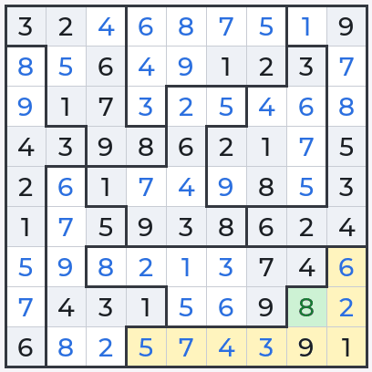

<!-- Written by tools/walkthrough.py jigsaw: edit the script, not this page. -->
# Jigsaw, step 43: the 8 in region 9

**Step 43 of 43** · [← Step 42](step-42.md) · [All steps](../jigsaw.md#the-whole-puzzle-step-by-step) · [All steps](../jigsaw.md#the-whole-puzzle-step-by-step)

Region 9 needs an 8, and r8c8 is its last empty cell: **r8c8 = 8**.

Solved.

**Step 43 of 43** · [← Step 42](step-42.md) · [All steps](../jigsaw.md#the-whole-puzzle-step-by-step) · [All steps](../jigsaw.md#the-whole-puzzle-step-by-step)
