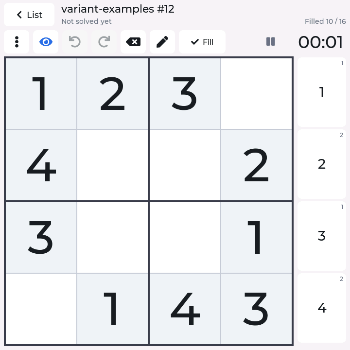
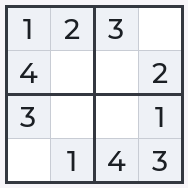
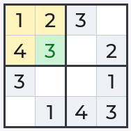
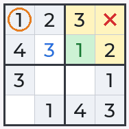
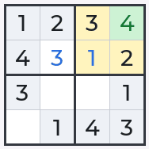
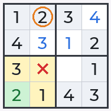
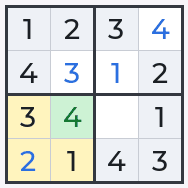
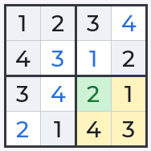

# Kids 4×4

[← All variants](README.md) · [Puzzles](../features-puzzles.md) · [How to play](../how-to-play.md)

## The rules

A small grid for younger players: 4 rows, 4 columns and four **2×2 boxes**. Every row, every column and every box holds **1, 2, 3 and 4**, each once.

## On the board

- Big cells with big digits, a four-key number pad, and pencil marks two by two.
- **Puzzles → ⋮ → New puzzle → Kids 4x4**, at Easy or Medium (Hard and Expert are greyed out: a 4×4 grid never needs their techniques). Easy leaves 8 to 10 of the 16 cells filled, Medium about 5.
- It has its own statistics row and record (Fastest Kids 4x4).

## How to solve it

- **Find the missing one:** a row, column or box with three digits needs the fourth.
- **Where can it go?** For a digit a box still needs, check which of its empty cells already have that digit in their row or column. If only one cell is left, it goes there.
- Say it out loud with a child: "This box needs a 1. Can the 1 go here? No, this row already has a 1."

## Worked example

**variant-examples #12**, Kids 4×4 Easy (see [Classic](classic.md#worked-example-the-whole-puzzle) for how to import the examples; cells are written r*row*c*column*). Box 1 is the top-left 2×2, box 2 the top-right.

**Step 1: the 3 in box 1.** Box 1 has 1, 2 and 4, so it needs a 3, and it has one empty cell, r2c2. **r2c2 = 3**.

**Step 2: the 1 in box 2.** Box 2 has 3 and 2; its empty cells are r1c4 and r2c3. Row 1 already has a 1 (r1c1), so the 1 can't be in r1c4. **r2c3 = 1**.

**Step 3: the 4 in box 2.** Box 2 now has 3, 1 and 2; the last cell, r1c4, takes the 4. **r1c4 = 4**.

The bottom half goes the same way: row 3 needs 2 and 4, row 4 needs 2.

## The whole puzzle, step by step

<!-- walkthrough -->
<!-- Written by tools/walkthrough.py kids-4x4: edit the script, not this part. -->

The whole puzzle, from the start to the last cell: 6 steps, each one a single (one place left for a digit, or one digit left for a cell), taken in the order a box's single comes first, so not quite the order of the worked example above. In each picture, the unit the step looks at is tinted yellow (for a cell with one digit left: its row, column and box), the new digit is on green, the digits that rule cells out have an **orange ring**, and the empty cells they rule out a **red cross**. Givens are on grey, digits from earlier steps in blue.

#### Step 1: the 3 in box 1

Box 1 needs a 3, and r2c2 is its last empty cell: **r2c2 = 3**.

#### Step 2: the 1 in box 2

Box 2 needs a 1. r1c4: row 1 has one (r1c1). Only **r2c3** is left: **r2c3 = 1**.

#### Step 3: the 4 in box 2

Box 2 needs a 4, and r1c4 is its last empty cell: **r1c4 = 4**.

#### Step 4: the 2 in box 3

Box 3 needs a 2. r3c2: column 2 has one (r1c2). Only **r4c1** is left: **r4c1 = 2**.

#### Step 5: the 4 in box 3

Box 3 needs a 4, and r3c2 is its last empty cell: **r3c2 = 4**.

#### Step 6: the 2 in box 4

Box 4 needs a 2, and r3c3 is its last empty cell: **r3c3 = 2**.

Solved.

<!-- /walkthrough -->
