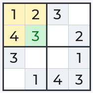

<!-- Written by tools/walkthrough.py kids-4x4: edit the script, not this page. -->
# Kids 4x4, step 1: the 3 in box 1

**Step 1 of 6** · [← The start](../kids-4x4.md#the-whole-puzzle-step-by-step) · [All steps](../kids-4x4.md#the-whole-puzzle-step-by-step) · [Step 2 →](step-02.md)

Box 1 needs a 3, and r2c2 is its last empty cell: **r2c2 = 3**.

**Step 1 of 6** · [← The start](../kids-4x4.md#the-whole-puzzle-step-by-step) · [All steps](../kids-4x4.md#the-whole-puzzle-step-by-step) · [Step 2 →](step-02.md)
