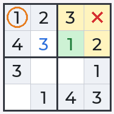

<!-- Written by tools/walkthrough.py kids-4x4: edit the script, not this page. -->
# Kids 4x4, step 2: the 1 in box 2

**Step 2 of 6** · [← Step 1](step-01.md) · [All steps](../kids-4x4.md#the-whole-puzzle-step-by-step) · [Step 3 →](step-03.md)

Box 2 needs a 1. r1c4: row 1 has one (r1c1). Only **r2c3** is left: **r2c3 = 1**.

**Step 2 of 6** · [← Step 1](step-01.md) · [All steps](../kids-4x4.md#the-whole-puzzle-step-by-step) · [Step 3 →](step-03.md)
