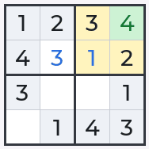

<!-- Written by tools/walkthrough.py kids-4x4: edit the script, not this page. -->
# Kids 4x4, step 3: the 4 in box 2

**Step 3 of 6** · [← Step 2](step-02.md) · [All steps](../kids-4x4.md#the-whole-puzzle-step-by-step) · [Step 4 →](step-04.md)

Box 2 needs a 4, and r1c4 is its last empty cell: **r1c4 = 4**.

**Step 3 of 6** · [← Step 2](step-02.md) · [All steps](../kids-4x4.md#the-whole-puzzle-step-by-step) · [Step 4 →](step-04.md)
