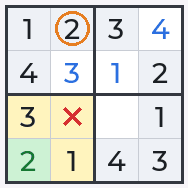

<!-- Written by tools/walkthrough.py kids-4x4: edit the script, not this page. -->
# Kids 4x4, step 4: the 2 in box 3

**Step 4 of 6** · [← Step 3](step-03.md) · [All steps](../kids-4x4.md#the-whole-puzzle-step-by-step) · [Step 5 →](step-05.md)

Box 3 needs a 2. r3c2: column 2 has one (r1c2). Only **r4c1** is left: **r4c1 = 2**.

**Step 4 of 6** · [← Step 3](step-03.md) · [All steps](../kids-4x4.md#the-whole-puzzle-step-by-step) · [Step 5 →](step-05.md)
