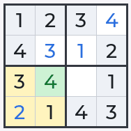

<!-- Written by tools/walkthrough.py kids-4x4: edit the script, not this page. -->
# Kids 4x4, step 5: the 4 in box 3

**Step 5 of 6** · [← Step 4](step-04.md) · [All steps](../kids-4x4.md#the-whole-puzzle-step-by-step) · [Step 6 →](step-06.md)

Box 3 needs a 4, and r3c2 is its last empty cell: **r3c2 = 4**.

**Step 5 of 6** · [← Step 4](step-04.md) · [All steps](../kids-4x4.md#the-whole-puzzle-step-by-step) · [Step 6 →](step-06.md)
