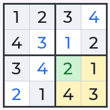

<!-- Written by tools/walkthrough.py kids-4x4: edit the script, not this page. -->
# Kids 4x4, step 6: the 2 in box 4

**Step 6 of 6** · [← Step 5](step-05.md) · [All steps](../kids-4x4.md#the-whole-puzzle-step-by-step) · [All steps](../kids-4x4.md#the-whole-puzzle-step-by-step)

Box 4 needs a 2, and r3c3 is its last empty cell: **r3c3 = 2**.

Solved.

**Step 6 of 6** · [← Step 5](step-05.md) · [All steps](../kids-4x4.md#the-whole-puzzle-step-by-step) · [All steps](../kids-4x4.md#the-whole-puzzle-step-by-step)
