# Killer

[← All variants](README.md) · [Puzzles](../features-puzzles.md) · [How to play](../how-to-play.md)

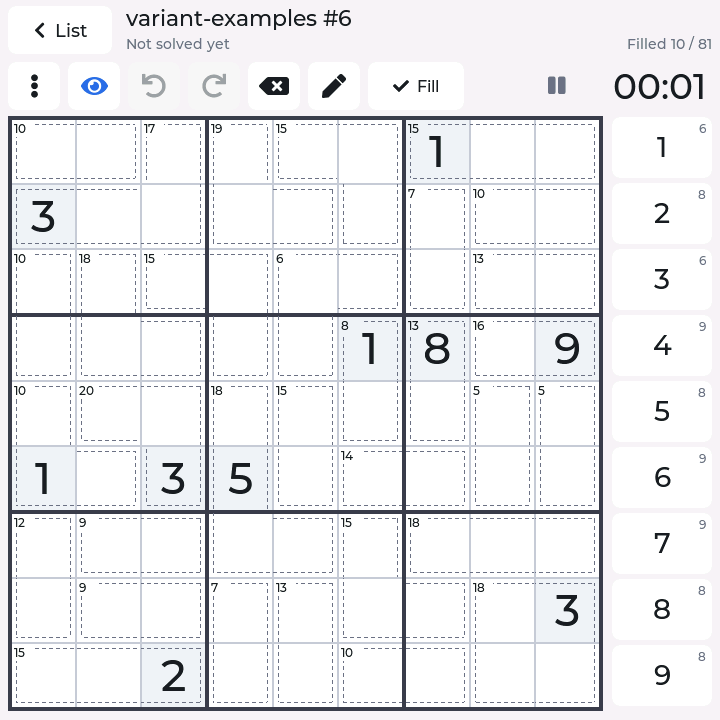

## The rules

[Classic](classic.md) rules, plus **cages**: groups of 2 to 5 connected cells outlined with a dashed line, with a small **sum** in the top-left corner. The digits in a cage add up to its sum, and **no digit repeats within a cage**. Killer puzzles have few givens, or none: the cages carry the information.

## On the board

- Each cage is a dashed outline; its sum is in its top-left cell. Pencil marks are drawn smaller so they stay clear of the sum.
- A cage whose digits go over its sum, or that's full and short of it, turns red; so does a digit repeated in a cage.
- **Hold a cell** to see which digits can still make up its cage (the cage helper).
- **Puzzles → ⋮ → New puzzle → Killer**: Easy and Medium use cages of 2 or 3 cells, Hard and Expert up to 5. It's Friday's daily puzzle (Medium).

## How to solve it

- **Two-cell cages with a given:** the other cell is the sum minus that digit.
- **Small and big sums have few combinations:** 3 in two cells is always 1 + 2; 4 is 1 + 3; 16 is 7 + 9; 17 is 8 + 9; 6 in three cells is 1 + 2 + 3; 24 in three is 7 + 8 + 9.
- **Impossible digits:** a digit that would need its partner to be 10 or more, or 0 or less, or a repeat, can't go in the cage. That's what the worked example uses.
- **The rule of 45:** a row, column or box adds up to 45. If cages cover a box except for one cell, that cell is 45 minus the cages' sums; if one cage pokes out of the box, the cell sticking out is the cages' total minus 45.

## Worked example

**variant-examples #6**, Killer Easy (see [Classic](classic.md#worked-example-the-whole-puzzle) for how to import the examples; cells are written r*row*c*column*). The cages are in the screenshot; these three matter:

- the bottom-left cage: **15** over r9c1, r9c2 and r9c3 (r9c3 is a given 2);
- a two-cell cage of **13**: r4c7 (a given 8) and r5c7;
- a two-cell cage of **16**: r4c8 and r4c9 (a given 9).

**Step 1: the 3 in column 2.** Column 2 needs a 3. Go down it:

- r1c2, r2c2, r3c2: box 1 has a 3 (r2c1).
- r4c2, r5c2, r6c2: box 4 has a 3 (r6c3).
- r8c2: row 8 has a 3 (r8c9).
- r9c2: it's in the bottom-left cage of 15 with the given 2, so r9c1 + r9c2 = 13. If r9c2 were 3, r9c1 would have to be 10. Impossible.

Only **r7c2** is left: **r7c2 = 3**. Without the cage, r9c2 would still be open.

**Step 2: the 3 in column 7.** r1c7 and r4c7 are filled; r2c7, r6c7, r7c7 (the 3 just placed in row 7), r8c7 and r9c7 all see a 3 in their row or box. That leaves r3c7 and **r5c7**, and r5c7 is in the cage of 13 with the 8: it must be 13 − 8 = 5, not 3. **r3c7 = 3**.

**Step 3: the 3 in column 8.** r1c8 and r3c8 see the 3 just placed in r3c7 (box 3, row 3); r2c8, r6c8, r7c8, r8c8 and r9c8 see a 3 in their row or box. That leaves r5c8 and **r4c8**, and r4c8 is in the cage of 16 with the 9: it must be 7. **r5c8 = 3**.

The same cages give two more digits at once: **r5c7 = 5** and **r4c8 = 7**. Killer often goes like this: a few sums fixed early, then the Classic rules take over.

## The whole puzzle, step by step

<!-- walkthrough -->
<!-- Written by tools/walkthrough.py killer: edit the script, not this part. -->

The whole puzzle, from the start to the last cell: 71 steps, each one a single (one place left for a digit, or one digit left for a cell), taken in the order a box's single comes first, so not quite the order of the worked example above. In each picture, the unit the step looks at is tinted yellow (for a cell with one digit left: its row, column and box), the new digit is on green, the digits that rule cells out have an **orange ring**, and the empty cells they rule out a **red cross**. Givens are on grey, digits from earlier steps in blue.

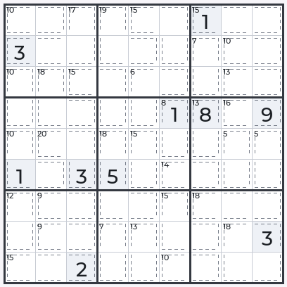

#### Step 1: the 3 in box 3

Box 3 needs a 3. r1c9 and r3c9: column 9 has one (r8c9). r2c7, r2c8 and r2c9: row 2 has one (r2c1). r1c8: in the cage of 15 (with 1 already in it), a 3 would leave 11 for its other cell, too much. r3c8: in the cage of 13, a 3 would leave 10 for its other cell, too much. Only **r3c7** is left: **r3c7 = 3**.

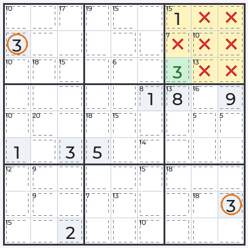

#### Step 2: the 3 in box 6

Box 6 needs a 3. r5c7: column 7 has one (r3c7). r5c9: column 9 has one (r8c9). r6c7, r6c8 and r6c9: row 6 has one (r6c3). r4c8: the cage of 16 (with 9 already in it) needs 7 there. Only **r5c8** is left: **r5c8 = 3**.

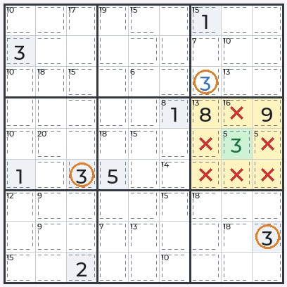

#### Step 3: the 1 in box 6

Box 6 needs a 1. r4c8: row 4 has one (r4c6). r5c7: column 7 has one (r1c7). r6c7, r6c8 and r6c9: row 6 has one (r6c1). Only **r5c9** is left: **r5c9 = 1**.

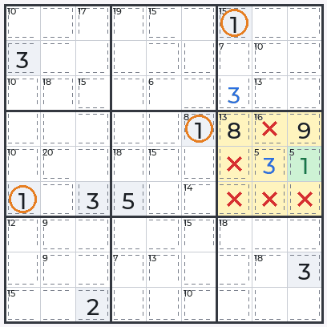

#### Step 4: the 2 in box 6

Box 6 needs a 2. r4c8: the cage of 16 (with 9 already in it) needs 7 there. r5c7: the cage of 13 (with 8 already in it) needs 5 there. r6c7: in the cage of 14, a 2 would leave 12 for its other cell, too much. r6c9: the cage of 5 (with 1 already in it) needs 4 there. Only **r6c8** is left: **r6c8 = 2**.

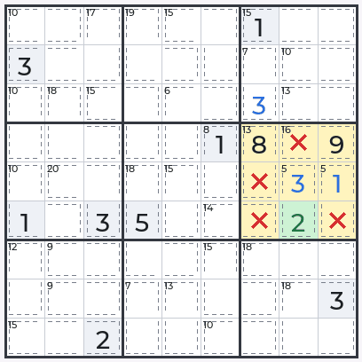

#### Step 5: the 2 in box 3

Box 3 needs a 2. r1c8, r2c8 and r3c8: column 8 has one (r6c8). r1c9: in the cage of 15 (with 1 already in it), a 2 would leave 12 for its other cell, too much. r2c7: the cage of 7 (with 3 already in it) needs 4 there. r3c9: in the cage of 13, a 2 would leave 11 for its other cell, too much. Only **r2c9** is left: **r2c9 = 2**.

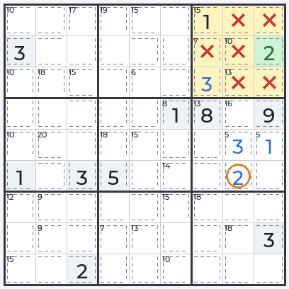

#### Step 6: the 4 in box 6

Box 6 needs a 4. r4c8: the cage of 16 (with 9 already in it) needs 7 there. r5c7: the cage of 13 (with 8 already in it) needs 5 there. r6c7: in the cage of 14, a 4 would leave 10 for its other cell, too much. Only **r6c9** is left: **r6c9 = 4**.

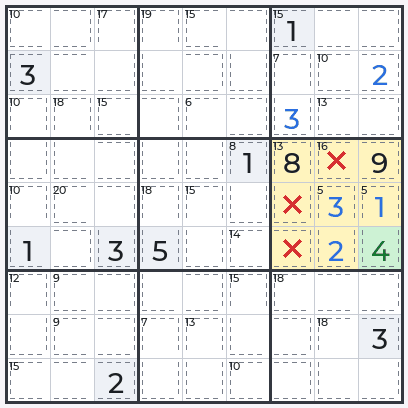

#### Step 7: the 5 in box 6

Box 6 needs a 5. r6c7: row 6 has one (r6c4). r4c8: the cage of 16 (with 9 already in it) needs 7 there. Only **r5c7** is left: **r5c7 = 5**.

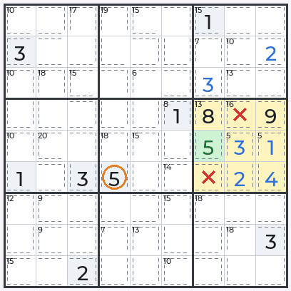

#### Step 8: the 6 in box 6

Box 6 needs a 6. r4c8: the cage of 16 (with 9 already in it) needs 7 there. Only **r6c7** is left: **r6c7 = 6**.

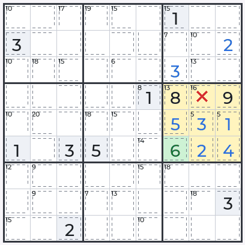

#### Step 9: the 7 in box 6

Box 6 needs a 7, and r4c8 is its last empty cell: **r4c8 = 7**.

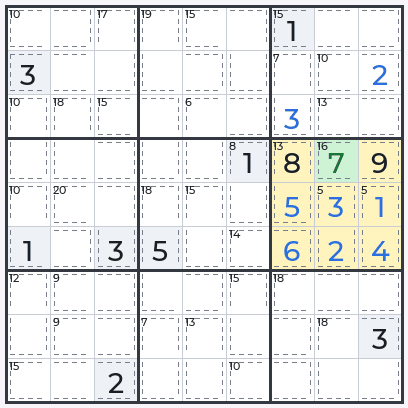

#### Step 10: the 3 in box 7

Box 7 needs a 3. r7c1 and r9c1: column 1 has one (r2c1). r7c3: column 3 has one (r6c3). r8c1, r8c2 and r8c3: row 8 has one (r8c9). r9c2: in the cage of 15 (with 2 already in it), a 3 would leave 10 for its other cell, too much. Only **r7c2** is left: **r7c2 = 3**.

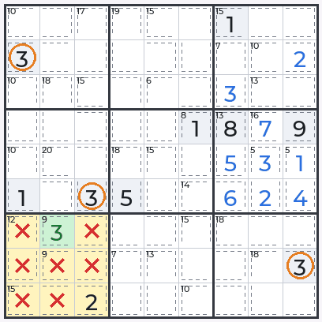

#### Step 11: the 9 in row 6

Row 6 needs a 9. r6c2: in the cage of 10 (with 1 already in it), a 9 would leave 0 for its other cell, too little. r6c6: the cage of 14 (with 6 already in it) needs 8 there. Only **r6c5** is left: **r6c5 = 9**.

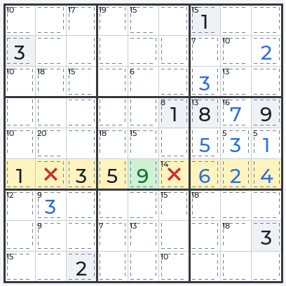

#### Step 12: the 7 in row 6

Row 6 needs a 7. r6c6: the cage of 14 (with 6 already in it) needs 8 there. Only **r6c2** is left: **r6c2 = 7**.

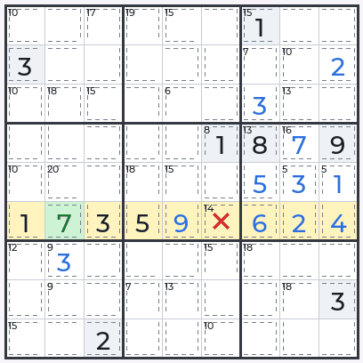

#### Step 13: the 4 in row 5

Row 5 needs a 4. r5c1: the cage of 10 (with 1 and 7 already in it) needs 2 there. r5c2 and r5c3: in the cage of 20 (with 3 already in it), a 4 would leave 13 for its other cell, too much. r5c5: the cage of 15 (with 9 already in it) needs 6 there. r5c6: the cage of 8 (with 1 already in it) needs 7 there. Only **r5c4** is left: **r5c4 = 4**.

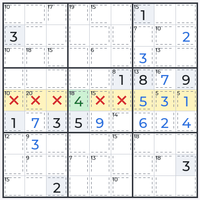

#### Step 14: the 7 in box 5

Box 5 needs a 7. r4c4 and r4c5: row 4 has one (r4c8). r6c6: row 6 has one (r6c2). r5c5: the cage of 15 (with 9 already in it) needs 6 there. Only **r5c6** is left: **r5c6 = 7**.

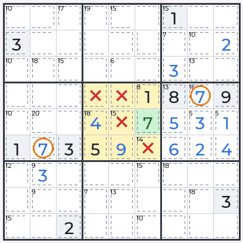

#### Step 15: the 8 in box 5

Box 5 needs an 8. r4c4 and r4c5: row 4 has one (r4c7). r5c5: the cage of 15 (with 9 already in it) needs 6 there. Only **r6c6** is left: **r6c6 = 8**.

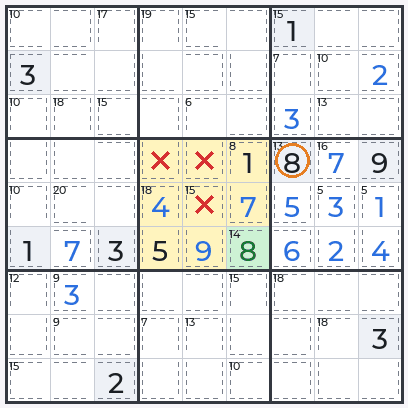

#### Step 16: the 2 in row 5

Row 5 needs a 2. r5c3: column 3 has one (r9c3). r5c2: in the cage of 20 (with 3 already in it), a 2 would leave 15 for its other cell, too much. r5c5: the cage of 15 (with 9 already in it) needs 6 there. Only **r5c1** is left: **r5c1 = 2**.

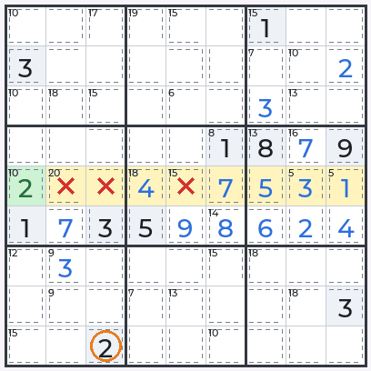

#### Step 17: the 6 in row 5

Row 5 needs a 6. r5c2 and r5c3: in the cage of 20 (with 3 already in it), a 6 would leave 11 for its other cell, too much. Only **r5c5** is left: **r5c5 = 6**.

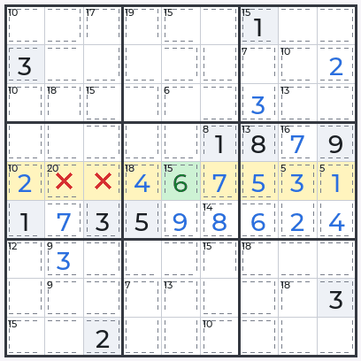

#### Step 18: r2c7

Column 7 has 1, 5, 6 and 8; row 2 has 2 and 3. Not 7 or 9: the cage of 7 (with 3 already in it) needs 4 there. Only 4 is left: **r2c7 = 4**.

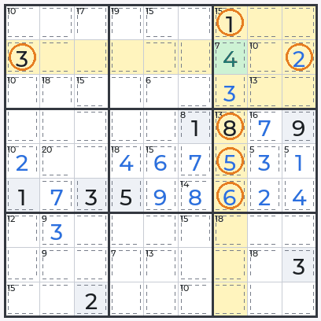

#### Step 19: r2c8

Box 3 has 1; row 2 has 2, 3 and 4; column 8 has 7. Not 5, 6 or 9: the cage of 10 (with 2 already in it) needs 8 there. Only 8 is left: **r2c8 = 8**.

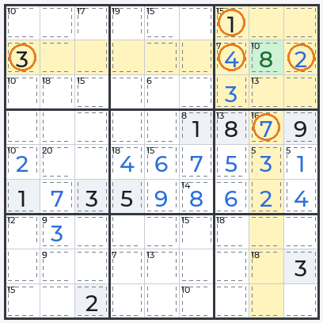

#### Step 20: r3c6

Column 6 has 1, 7 and 8; row 3 has 3. Not 4: in the cage of 6, a 4 would leave 2 for its other 2 cells, too little. Not 5: in the cage of 6, a 5 would leave 1 for its other 2 cells, too little. Not 6: in the cage of 6, a 6 would leave 0 for its other 2 cells, too little. Not 9: in the cage of 6, a 9 would leave -3 for its other 2 cells, too little. Only 2 is left: **r3c6 = 2**.

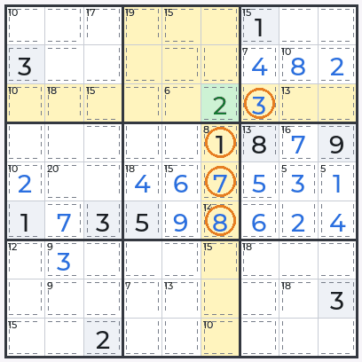

#### Step 21: the 2 in box 1

Box 1 needs a 2. r1c1: column 1 has one (r5c1). r1c3: column 3 has one (r9c3). r2c2 and r2c3: row 2 has one (r2c9). r3c1, r3c2 and r3c3: row 3 has one (r3c6). Only **r1c2** is left: **r1c2 = 2**.

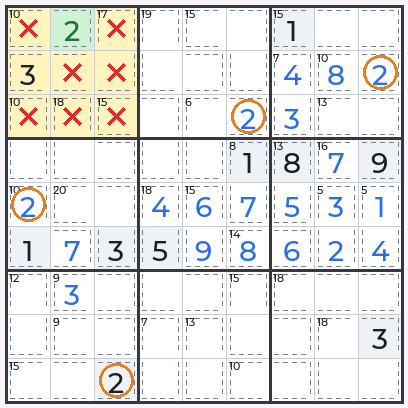

#### Step 22: the 2 in box 5

Box 5 needs a 2. r4c5: the cage of 6 (with 2 already in it) has a 2 already. Only **r4c4** is left: **r4c4 = 2**.

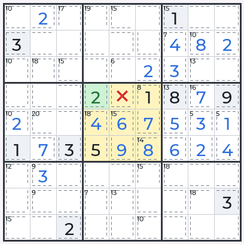

#### Step 23: the 1 in box 2

Box 2 needs a 1. r1c4, r1c5 and r1c6: row 1 has one (r1c7). r2c6: column 6 has one (r4c6). r2c4 and r2c5: in the cage of 19, a 1 would leave 18 for its other 2 cells, too much. r3c4: in the cage of 15 (with 2 already in it), a 1 would leave 12 for its other cell, too much. Only **r3c5** is left: **r3c5 = 1**.

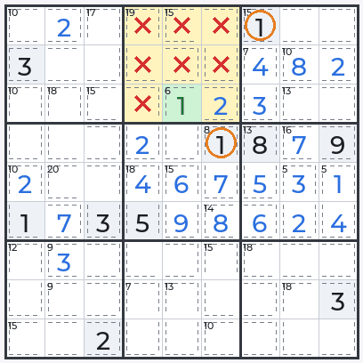

#### Step 24: the 3 in box 5

Box 5 needs a 3, and r4c5 is its last empty cell: **r4c5 = 3**.

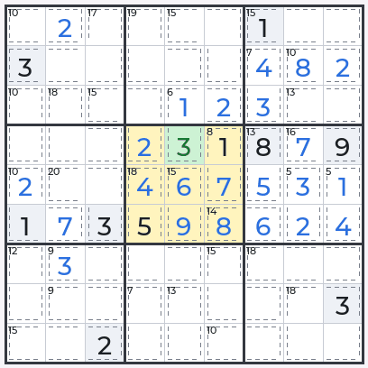

#### Step 25: the 2 in box 8

Box 8 needs a 2. r7c4 and r8c4: column 4 has one (r4c4). r7c6 and r8c6: column 6 has one (r3c6). r9c4, r9c5 and r9c6: row 9 has one (r9c3). r8c5: in the cage of 13, a 2 would leave 11 for its other cell, too much. Only **r7c5** is left: **r7c5 = 2**.

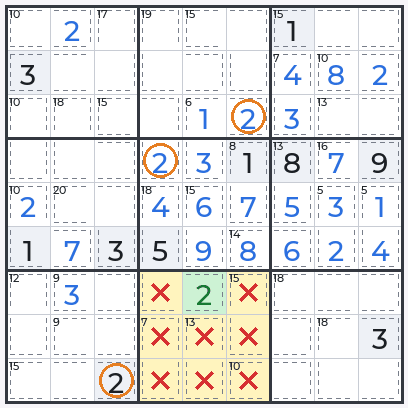

#### Step 26: the 2 in box 9

Box 9 needs a 2. r7c7, r7c8 and r7c9: row 7 has one (r7c5). r8c8: column 8 has one (r6c8). r9c7, r9c8 and r9c9: row 9 has one (r9c3). Only **r8c7** is left: **r8c7 = 2**.

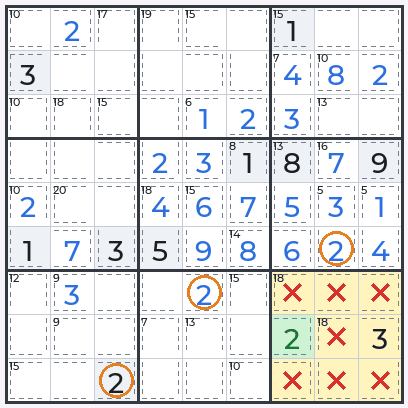

#### Step 27: the 1 in row 7

Row 7 needs a 1. r7c1: column 1 has one (r6c1). r7c6: column 6 has one (r4c6). r7c7: column 7 has one (r1c7). r7c9: column 9 has one (r5c9). r7c3: the cage of 9 (with 3 already in it) needs 6 there. r7c4: the cage of 18 (with 4, 5 and 2 already in it) needs 7 there. Only **r7c8** is left: **r7c8 = 1**.

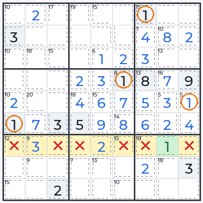

#### Step 28: the 1 in row 9

Row 9 needs a 1. r9c1: column 1 has one (r6c1). r9c5: column 5 has one (r3c5). r9c6: column 6 has one (r4c6). r9c7: column 7 has one (r1c7). r9c8: column 8 has one (r7c8). r9c9: column 9 has one (r5c9). r9c2: in the cage of 15 (with 2 already in it), a 1 would leave 12 for its other cell, too much. Only **r9c4** is left: **r9c4 = 1**.

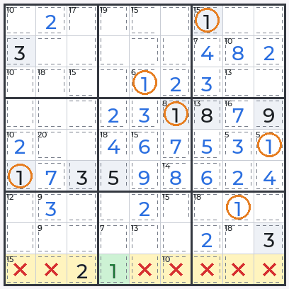

#### Step 29: the 3 in box 8

Box 8 needs a 3. r7c4 and r7c6: row 7 has one (r7c2). r8c4, r8c5 and r8c6: row 8 has one (r8c9). r9c5: column 5 has one (r4c5). Only **r9c6** is left: **r9c6 = 3**.

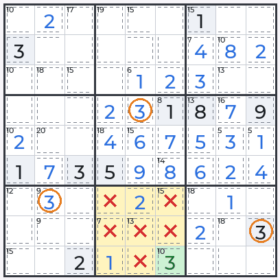

#### Step 30: the 3 in box 2

Box 2 needs a 3. r1c5: column 5 has one (r4c5). r1c6: column 6 has one (r9c6). r2c4, r2c5 and r2c6: row 2 has one (r2c1). r3c4: row 3 has one (r3c7). Only **r1c4** is left: **r1c4 = 3**.

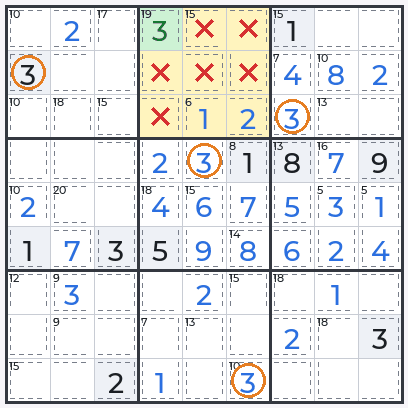

#### Step 31: the 8 in column 4

Column 4 needs an 8. r2c4: row 2 has one (r2c8). r7c4: the cage of 18 (with 4, 5 and 2 already in it) needs 7 there. r8c4: the cage of 7 (with 1 already in it) needs 6 there. Only **r3c4** is left: **r3c4 = 8**.

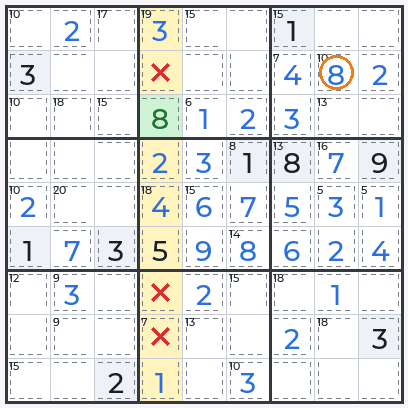

#### Step 32: the 6 in column 4

Column 4 needs a 6. r2c4: in the cage of 19 (with 3 already in it), a 6 would leave 10 for its other cell, too much. r7c4: the cage of 18 (with 4, 5 and 2 already in it) needs 7 there. Only **r8c4** is left: **r8c4 = 6**.

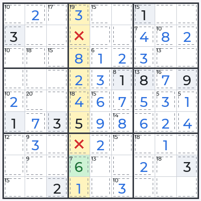

#### Step 33: the 9 in column 4

Column 4 needs a 9. r7c4: the cage of 18 (with 4, 5 and 2 already in it) needs 7 there. Only **r2c4** is left: **r2c4 = 9**.

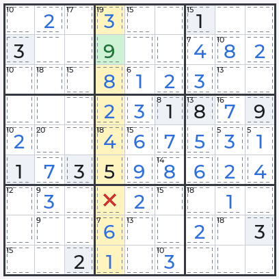

#### Step 34: the 7 in column 4

Column 4 needs a 7, and r7c4 is its last empty cell: **r7c4 = 7**.

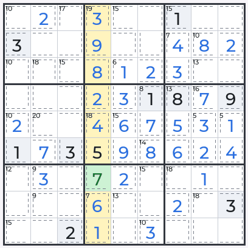

#### Step 35: the 7 in column 7

Column 7 needs a 7. r7c7: row 7 has one (r7c4). Only **r9c7** is left: **r9c7 = 7**.

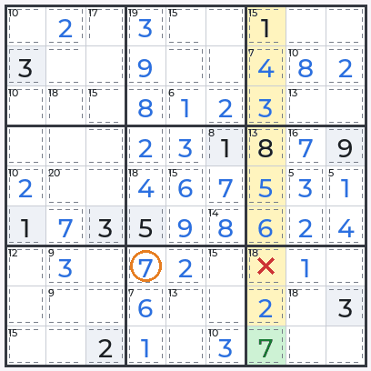

#### Step 36: the 9 in column 7

Column 7 needs a 9, and r7c7 is its last empty cell: **r7c7 = 9**.

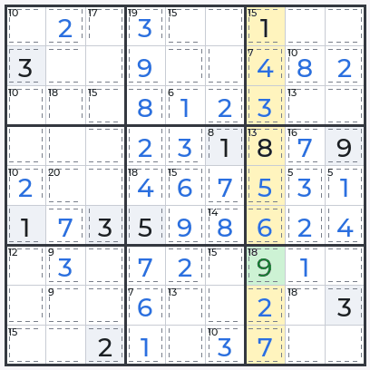

#### Step 37: the 9 in box 8

Box 8 needs a 9. r7c6: row 7 has one (r7c7). r8c5 and r9c5: column 5 has one (r6c5). Only **r8c6** is left: **r8c6 = 9**.

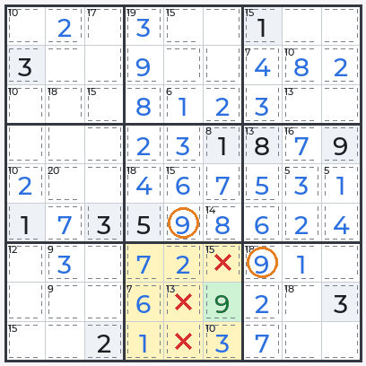

#### Step 38: the 5 in row 7

Row 7 needs a 5. r7c3: the cage of 9 (with 3 already in it) needs 6 there. r7c6: the cage of 15 (with 9 and 2 already in it) needs 4 there. r7c9: the cage of 18 (with 9 and 1 already in it) needs 8 there. Only **r7c1** is left: **r7c1 = 5**.

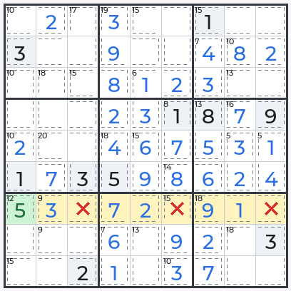

#### Step 39: the 4 in row 7

Row 7 needs a 4. r7c9: column 9 has one (r6c9). r7c3: the cage of 9 (with 3 already in it) needs 6 there. Only **r7c6** is left: **r7c6 = 4**.

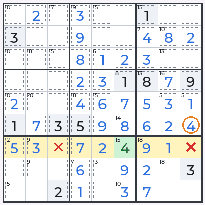

#### Step 40: the 4 in box 2

Box 2 needs a 4. r1c6: column 6 has one (r7c6). r2c5 and r2c6: row 2 has one (r2c7). Only **r1c5** is left: **r1c5 = 4**.

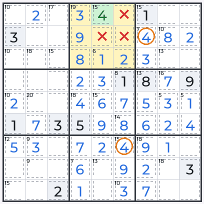

#### Step 41: the 7 in box 2

Box 2 needs a 7. r1c6 and r2c6: column 6 has one (r5c6). Only **r2c5** is left: **r2c5 = 7**.

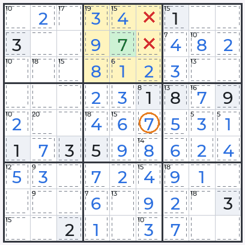

#### Step 42: the 6 in row 7

Row 7 needs a 6. r7c9: the cage of 18 (with 9 and 1 already in it) needs 8 there. Only **r7c3** is left: **r7c3 = 6**.

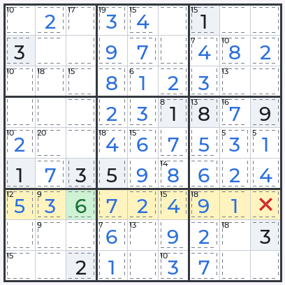

#### Step 43: the 8 in row 7

Row 7 needs an 8, and r7c9 is its last empty cell: **r7c9 = 8**.

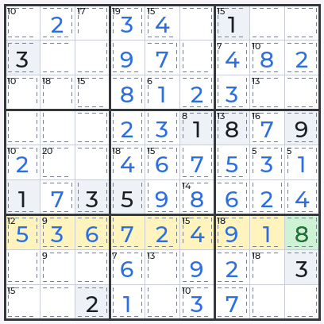

#### Step 44: r1c1

Row 1 has 1, 2, 3 and 4; column 1 has 5. Not 6, 7 or 9: the cage of 10 (with 2 already in it) needs 8 there. Only 8 is left: **r1c1 = 8**.

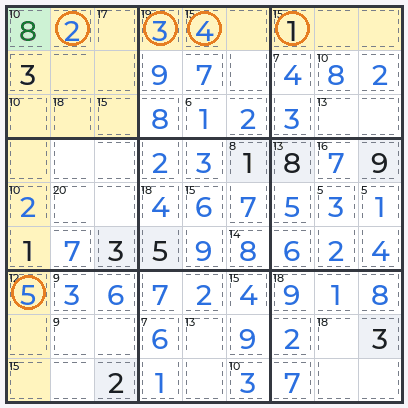

#### Step 45: r3c3

Row 3 has 1, 2, 3 and 8; column 3 has 6. Not 4, 7 or 9: the cage of 15 (with 8 and 2 already in it) needs 5 there. Only 5 is left: **r3c3 = 5**.

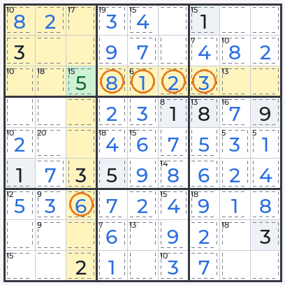

#### Step 46: the 5 in box 4

Box 4 needs a 5. r4c1: column 1 has one (r7c1). r4c3: column 3 has one (r3c3). r5c2 and r5c3: row 5 has one (r5c7). Only **r4c2** is left: **r4c2 = 5**.

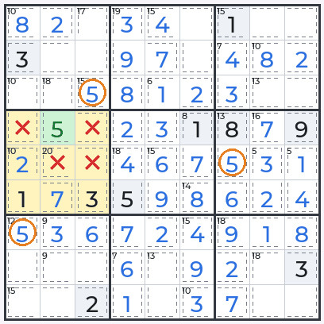

#### Step 47: the 6 in box 4

Box 4 needs a 6. r4c3: column 3 has one (r7c3). r5c2 and r5c3: row 5 has one (r5c5). Only **r4c1** is left: **r4c1 = 6**.

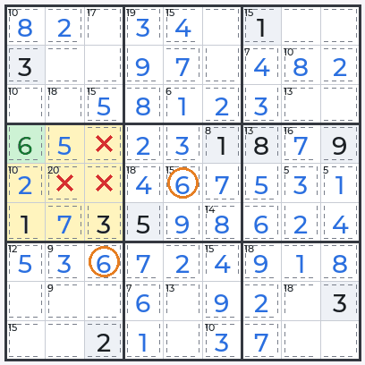

#### Step 48: the 7 in box 1

Box 1 needs a 7. r2c2 and r2c3: row 2 has one (r2c5). r3c2: column 2 has one (r6c2). r3c1: the cage of 10 (with 6 already in it) needs 4 there. Only **r1c3** is left: **r1c3 = 7**.

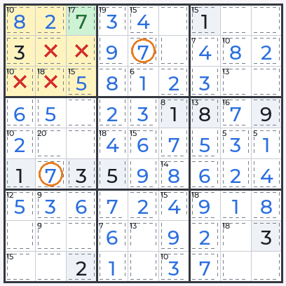

#### Step 49: the 9 in box 1

Box 1 needs a 9. r2c2 and r2c3: row 2 has one (r2c4). r3c1: the cage of 10 (with 6 already in it) needs 4 there. Only **r3c2** is left: **r3c2 = 9**.

#### Step 50: the 4 in box 1

Box 1 needs a 4. r2c2 and r2c3: row 2 has one (r2c7). Only **r3c1** is left: **r3c1 = 4**.

#### Step 51: the 6 in box 1

Box 1 needs a 6. r2c3: column 3 has one (r7c3). Only **r2c2** is left: **r2c2 = 6**.

#### Step 52: the 1 in box 1

Box 1 needs a 1, and r2c3 is its last empty cell: **r2c3 = 1**.

#### Step 53: the 6 in box 2

Box 2 needs a 6. r2c6: row 2 has one (r2c2). Only **r1c6** is left: **r1c6 = 6**.

#### Step 54: the 5 in box 2

Box 2 needs a 5, and r2c6 is its last empty cell: **r2c6 = 5**.

#### Step 55: the 7 in box 3

Box 3 needs a 7. r1c8 and r1c9: row 1 has one (r1c3). r3c8: column 8 has one (r4c8). Only **r3c9** is left: **r3c9 = 7**.

#### Step 56: the 6 in box 3

Box 3 needs a 6. r1c8 and r1c9: row 1 has one (r1c6). Only **r3c8** is left: **r3c8 = 6**.

#### Step 57: the 9 in box 3

Box 3 needs a 9. r1c9: column 9 has one (r4c9). Only **r1c8** is left: **r1c8 = 9**.

#### Step 58: the 5 in box 3

Box 3 needs a 5, and r1c9 is its last empty cell: **r1c9 = 5**.

#### Step 59: the 4 in box 4

Box 4 needs a 4. r5c2 and r5c3: row 5 has one (r5c4). Only **r4c3** is left: **r4c3 = 4**.

#### Step 60: the 9 in box 4

Box 4 needs a 9. r5c2: column 2 has one (r3c2). Only **r5c3** is left: **r5c3 = 9**.

#### Step 61: the 8 in box 4

Box 4 needs an 8, and r5c2 is its last empty cell: **r5c2 = 8**.

#### Step 62: the 1 in box 7

Box 7 needs a 1. r8c1: column 1 has one (r6c1). r8c3: column 3 has one (r2c3). r9c1 and r9c2: row 9 has one (r9c4). Only **r8c2** is left: **r8c2 = 1**.

#### Step 63: the 4 in box 7

Box 7 needs a 4. r8c1 and r9c1: column 1 has one (r3c1). r8c3: column 3 has one (r4c3). Only **r9c2** is left: **r9c2 = 4**.

#### Step 64: the 7 in box 7

Box 7 needs a 7. r8c3: column 3 has one (r1c3). r9c1: row 9 has one (r9c7). Only **r8c1** is left: **r8c1 = 7**.

#### Step 65: the 8 in box 7

Box 7 needs an 8. r9c1: column 1 has one (r1c1). Only **r8c3** is left: **r8c3 = 8**.

#### Step 66: the 9 in box 7

Box 7 needs a 9, and r9c1 is its last empty cell: **r9c1 = 9**.

#### Step 67: the 8 in box 8

Box 8 needs an 8. r8c5: row 8 has one (r8c3). Only **r9c5** is left: **r9c5 = 8**.

#### Step 68: the 5 in box 8

Box 8 needs a 5, and r8c5 is its last empty cell: **r8c5 = 5**.

#### Step 69: the 4 in box 9

Box 9 needs a 4. r9c8 and r9c9: row 9 has one (r9c2). Only **r8c8** is left: **r8c8 = 4**.

#### Step 70: the 5 in box 9

Box 9 needs a 5. r9c9: column 9 has one (r1c9). Only **r9c8** is left: **r9c8 = 5**.

#### Step 71: the 6 in box 9

Box 9 needs a 6, and r9c9 is its last empty cell: **r9c9 = 6**.

Solved.

<!-- /walkthrough -->
