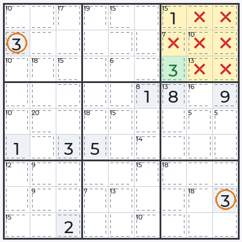

<!-- Written by tools/walkthrough.py killer: edit the script, not this page. -->
# Killer, step 1: the 3 in box 3

**Step 1 of 71** · [← The start](../killer.md#the-whole-puzzle-step-by-step) · [All steps](../killer.md#the-whole-puzzle-step-by-step) · [Step 2 →](step-02.md)

Box 3 needs a 3. r1c9 and r3c9: column 9 has one (r8c9). r2c7, r2c8 and r2c9: row 2 has one (r2c1). r1c8: in the cage of 15 (with 1 already in it), a 3 would leave 11 for its other cell, too much. r3c8: in the cage of 13, a 3 would leave 10 for its other cell, too much. Only **r3c7** is left: **r3c7 = 3**.

**Step 1 of 71** · [← The start](../killer.md#the-whole-puzzle-step-by-step) · [All steps](../killer.md#the-whole-puzzle-step-by-step) · [Step 2 →](step-02.md)
