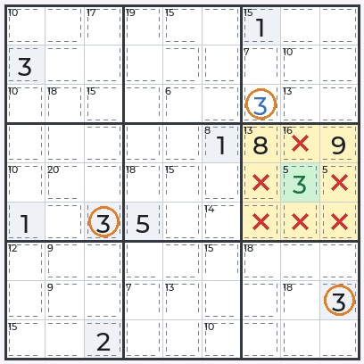

<!-- Written by tools/walkthrough.py killer: edit the script, not this page. -->
# Killer, step 2: the 3 in box 6

**Step 2 of 71** · [← Step 1](step-01.md) · [All steps](../killer.md#the-whole-puzzle-step-by-step) · [Step 3 →](step-03.md)

Box 6 needs a 3. r5c7: column 7 has one (r3c7). r5c9: column 9 has one (r8c9). r6c7, r6c8 and r6c9: row 6 has one (r6c3). r4c8: the cage of 16 (with 9 already in it) needs 7 there. Only **r5c8** is left: **r5c8 = 3**.

**Step 2 of 71** · [← Step 1](step-01.md) · [All steps](../killer.md#the-whole-puzzle-step-by-step) · [Step 3 →](step-03.md)
