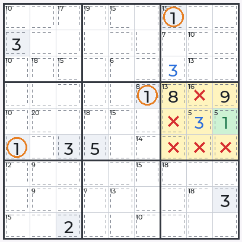

<!-- Written by tools/walkthrough.py killer: edit the script, not this page. -->
# Killer, step 3: the 1 in box 6

**Step 3 of 71** · [← Step 2](step-02.md) · [All steps](../killer.md#the-whole-puzzle-step-by-step) · [Step 4 →](step-04.md)

Box 6 needs a 1. r4c8: row 4 has one (r4c6). r5c7: column 7 has one (r1c7). r6c7, r6c8 and r6c9: row 6 has one (r6c1). Only **r5c9** is left: **r5c9 = 1**.

**Step 3 of 71** · [← Step 2](step-02.md) · [All steps](../killer.md#the-whole-puzzle-step-by-step) · [Step 4 →](step-04.md)
