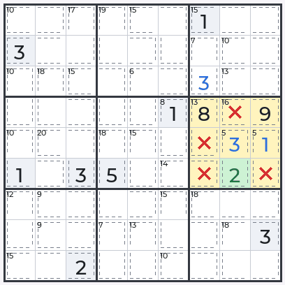

<!-- Written by tools/walkthrough.py killer: edit the script, not this page. -->
# Killer, step 4: the 2 in box 6

**Step 4 of 71** · [← Step 3](step-03.md) · [All steps](../killer.md#the-whole-puzzle-step-by-step) · [Step 5 →](step-05.md)

Box 6 needs a 2. r4c8: the cage of 16 (with 9 already in it) needs 7 there. r5c7: the cage of 13 (with 8 already in it) needs 5 there. r6c7: in the cage of 14, a 2 would leave 12 for its other cell, too much. r6c9: the cage of 5 (with 1 already in it) needs 4 there. Only **r6c8** is left: **r6c8 = 2**.

**Step 4 of 71** · [← Step 3](step-03.md) · [All steps](../killer.md#the-whole-puzzle-step-by-step) · [Step 5 →](step-05.md)
