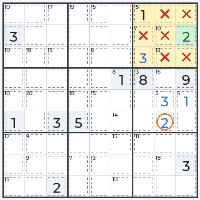

<!-- Written by tools/walkthrough.py killer: edit the script, not this page. -->
# Killer, step 5: the 2 in box 3

**Step 5 of 71** · [← Step 4](step-04.md) · [All steps](../killer.md#the-whole-puzzle-step-by-step) · [Step 6 →](step-06.md)

Box 3 needs a 2. r1c8, r2c8 and r3c8: column 8 has one (r6c8). r1c9: in the cage of 15 (with 1 already in it), a 2 would leave 12 for its other cell, too much. r2c7: the cage of 7 (with 3 already in it) needs 4 there. r3c9: in the cage of 13, a 2 would leave 11 for its other cell, too much. Only **r2c9** is left: **r2c9 = 2**.

**Step 5 of 71** · [← Step 4](step-04.md) · [All steps](../killer.md#the-whole-puzzle-step-by-step) · [Step 6 →](step-06.md)
