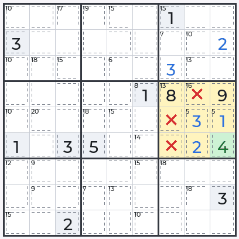

<!-- Written by tools/walkthrough.py killer: edit the script, not this page. -->
# Killer, step 6: the 4 in box 6

**Step 6 of 71** · [← Step 5](step-05.md) · [All steps](../killer.md#the-whole-puzzle-step-by-step) · [Step 7 →](step-07.md)

Box 6 needs a 4. r4c8: the cage of 16 (with 9 already in it) needs 7 there. r5c7: the cage of 13 (with 8 already in it) needs 5 there. r6c7: in the cage of 14, a 4 would leave 10 for its other cell, too much. Only **r6c9** is left: **r6c9 = 4**.

**Step 6 of 71** · [← Step 5](step-05.md) · [All steps](../killer.md#the-whole-puzzle-step-by-step) · [Step 7 →](step-07.md)
