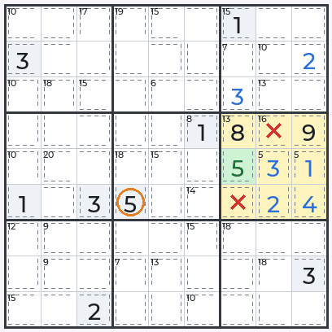

<!-- Written by tools/walkthrough.py killer: edit the script, not this page. -->
# Killer, step 7: the 5 in box 6

**Step 7 of 71** · [← Step 6](step-06.md) · [All steps](../killer.md#the-whole-puzzle-step-by-step) · [Step 8 →](step-08.md)

Box 6 needs a 5. r6c7: row 6 has one (r6c4). r4c8: the cage of 16 (with 9 already in it) needs 7 there. Only **r5c7** is left: **r5c7 = 5**.

**Step 7 of 71** · [← Step 6](step-06.md) · [All steps](../killer.md#the-whole-puzzle-step-by-step) · [Step 8 →](step-08.md)
