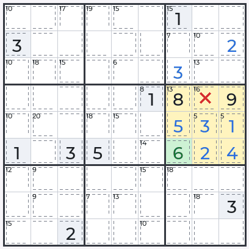

<!-- Written by tools/walkthrough.py killer: edit the script, not this page. -->
# Killer, step 8: the 6 in box 6

**Step 8 of 71** · [← Step 7](step-07.md) · [All steps](../killer.md#the-whole-puzzle-step-by-step) · [Step 9 →](step-09.md)

Box 6 needs a 6. r4c8: the cage of 16 (with 9 already in it) needs 7 there. Only **r6c7** is left: **r6c7 = 6**.

**Step 8 of 71** · [← Step 7](step-07.md) · [All steps](../killer.md#the-whole-puzzle-step-by-step) · [Step 9 →](step-09.md)
