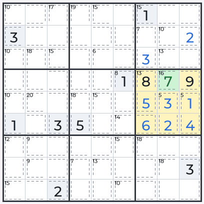

<!-- Written by tools/walkthrough.py killer: edit the script, not this page. -->
# Killer, step 9: the 7 in box 6

**Step 9 of 71** · [← Step 8](step-08.md) · [All steps](../killer.md#the-whole-puzzle-step-by-step) · [Step 10 →](step-10.md)

Box 6 needs a 7, and r4c8 is its last empty cell: **r4c8 = 7**.

**Step 9 of 71** · [← Step 8](step-08.md) · [All steps](../killer.md#the-whole-puzzle-step-by-step) · [Step 10 →](step-10.md)
