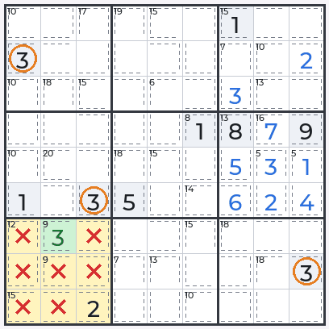

<!-- Written by tools/walkthrough.py killer: edit the script, not this page. -->
# Killer, step 10: the 3 in box 7

**Step 10 of 71** · [← Step 9](step-09.md) · [All steps](../killer.md#the-whole-puzzle-step-by-step) · [Step 11 →](step-11.md)

Box 7 needs a 3. r7c1 and r9c1: column 1 has one (r2c1). r7c3: column 3 has one (r6c3). r8c1, r8c2 and r8c3: row 8 has one (r8c9). r9c2: in the cage of 15 (with 2 already in it), a 3 would leave 10 for its other cell, too much. Only **r7c2** is left: **r7c2 = 3**.

**Step 10 of 71** · [← Step 9](step-09.md) · [All steps](../killer.md#the-whole-puzzle-step-by-step) · [Step 11 →](step-11.md)
