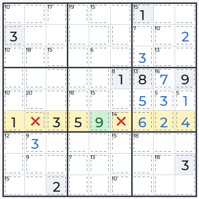

<!-- Written by tools/walkthrough.py killer: edit the script, not this page. -->
# Killer, step 11: the 9 in row 6

**Step 11 of 71** · [← Step 10](step-10.md) · [All steps](../killer.md#the-whole-puzzle-step-by-step) · [Step 12 →](step-12.md)

Row 6 needs a 9. r6c2: in the cage of 10 (with 1 already in it), a 9 would leave 0 for its other cell, too little. r6c6: the cage of 14 (with 6 already in it) needs 8 there. Only **r6c5** is left: **r6c5 = 9**.

**Step 11 of 71** · [← Step 10](step-10.md) · [All steps](../killer.md#the-whole-puzzle-step-by-step) · [Step 12 →](step-12.md)
