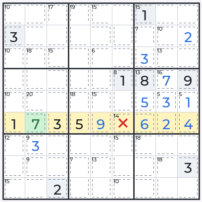

<!-- Written by tools/walkthrough.py killer: edit the script, not this page. -->
# Killer, step 12: the 7 in row 6

**Step 12 of 71** · [← Step 11](step-11.md) · [All steps](../killer.md#the-whole-puzzle-step-by-step) · [Step 13 →](step-13.md)

Row 6 needs a 7. r6c6: the cage of 14 (with 6 already in it) needs 8 there. Only **r6c2** is left: **r6c2 = 7**.

**Step 12 of 71** · [← Step 11](step-11.md) · [All steps](../killer.md#the-whole-puzzle-step-by-step) · [Step 13 →](step-13.md)
