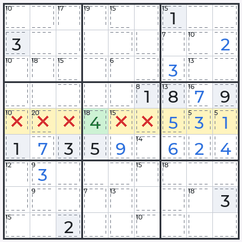

<!-- Written by tools/walkthrough.py killer: edit the script, not this page. -->
# Killer, step 13: the 4 in row 5

**Step 13 of 71** · [← Step 12](step-12.md) · [All steps](../killer.md#the-whole-puzzle-step-by-step) · [Step 14 →](step-14.md)

Row 5 needs a 4. r5c1: the cage of 10 (with 1 and 7 already in it) needs 2 there. r5c2 and r5c3: in the cage of 20 (with 3 already in it), a 4 would leave 13 for its other cell, too much. r5c5: the cage of 15 (with 9 already in it) needs 6 there. r5c6: the cage of 8 (with 1 already in it) needs 7 there. Only **r5c4** is left: **r5c4 = 4**.

**Step 13 of 71** · [← Step 12](step-12.md) · [All steps](../killer.md#the-whole-puzzle-step-by-step) · [Step 14 →](step-14.md)
