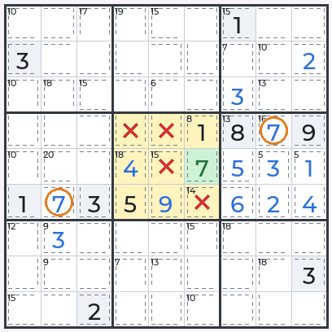

<!-- Written by tools/walkthrough.py killer: edit the script, not this page. -->
# Killer, step 14: the 7 in box 5

**Step 14 of 71** · [← Step 13](step-13.md) · [All steps](../killer.md#the-whole-puzzle-step-by-step) · [Step 15 →](step-15.md)

Box 5 needs a 7. r4c4 and r4c5: row 4 has one (r4c8). r6c6: row 6 has one (r6c2). r5c5: the cage of 15 (with 9 already in it) needs 6 there. Only **r5c6** is left: **r5c6 = 7**.

**Step 14 of 71** · [← Step 13](step-13.md) · [All steps](../killer.md#the-whole-puzzle-step-by-step) · [Step 15 →](step-15.md)
