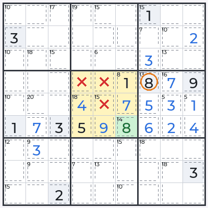

<!-- Written by tools/walkthrough.py killer: edit the script, not this page. -->
# Killer, step 15: the 8 in box 5

**Step 15 of 71** · [← Step 14](step-14.md) · [All steps](../killer.md#the-whole-puzzle-step-by-step) · [Step 16 →](step-16.md)

Box 5 needs an 8. r4c4 and r4c5: row 4 has one (r4c7). r5c5: the cage of 15 (with 9 already in it) needs 6 there. Only **r6c6** is left: **r6c6 = 8**.

**Step 15 of 71** · [← Step 14](step-14.md) · [All steps](../killer.md#the-whole-puzzle-step-by-step) · [Step 16 →](step-16.md)
