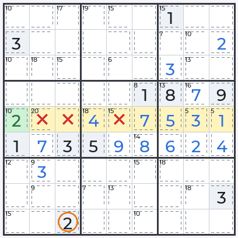

<!-- Written by tools/walkthrough.py killer: edit the script, not this page. -->
# Killer, step 16: the 2 in row 5

**Step 16 of 71** · [← Step 15](step-15.md) · [All steps](../killer.md#the-whole-puzzle-step-by-step) · [Step 17 →](step-17.md)

Row 5 needs a 2. r5c3: column 3 has one (r9c3). r5c2: in the cage of 20 (with 3 already in it), a 2 would leave 15 for its other cell, too much. r5c5: the cage of 15 (with 9 already in it) needs 6 there. Only **r5c1** is left: **r5c1 = 2**.

**Step 16 of 71** · [← Step 15](step-15.md) · [All steps](../killer.md#the-whole-puzzle-step-by-step) · [Step 17 →](step-17.md)
