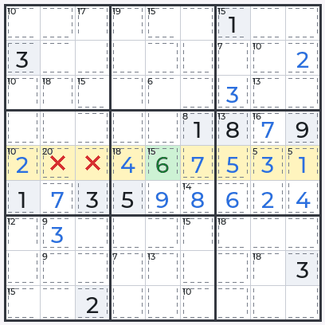

<!-- Written by tools/walkthrough.py killer: edit the script, not this page. -->
# Killer, step 17: the 6 in row 5

**Step 17 of 71** · [← Step 16](step-16.md) · [All steps](../killer.md#the-whole-puzzle-step-by-step) · [Step 18 →](step-18.md)

Row 5 needs a 6. r5c2 and r5c3: in the cage of 20 (with 3 already in it), a 6 would leave 11 for its other cell, too much. Only **r5c5** is left: **r5c5 = 6**.

**Step 17 of 71** · [← Step 16](step-16.md) · [All steps](../killer.md#the-whole-puzzle-step-by-step) · [Step 18 →](step-18.md)
