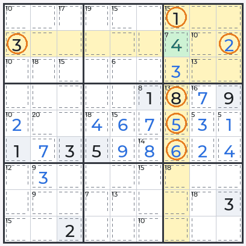

<!-- Written by tools/walkthrough.py killer: edit the script, not this page. -->
# Killer, step 18: r2c7

**Step 18 of 71** · [← Step 17](step-17.md) · [All steps](../killer.md#the-whole-puzzle-step-by-step) · [Step 19 →](step-19.md)

Column 7 has 1, 5, 6 and 8; row 2 has 2 and 3. Not 7 or 9: the cage of 7 (with 3 already in it) needs 4 there. Only 4 is left: **r2c7 = 4**.

**Step 18 of 71** · [← Step 17](step-17.md) · [All steps](../killer.md#the-whole-puzzle-step-by-step) · [Step 19 →](step-19.md)
