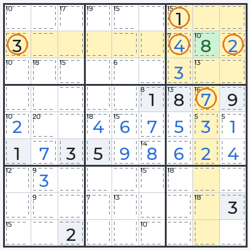

<!-- Written by tools/walkthrough.py killer: edit the script, not this page. -->
# Killer, step 19: r2c8

**Step 19 of 71** · [← Step 18](step-18.md) · [All steps](../killer.md#the-whole-puzzle-step-by-step) · [Step 20 →](step-20.md)

Box 3 has 1; row 2 has 2, 3 and 4; column 8 has 7. Not 5, 6 or 9: the cage of 10 (with 2 already in it) needs 8 there. Only 8 is left: **r2c8 = 8**.

**Step 19 of 71** · [← Step 18](step-18.md) · [All steps](../killer.md#the-whole-puzzle-step-by-step) · [Step 20 →](step-20.md)
