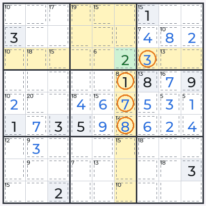

<!-- Written by tools/walkthrough.py killer: edit the script, not this page. -->
# Killer, step 20: r3c6

**Step 20 of 71** · [← Step 19](step-19.md) · [All steps](../killer.md#the-whole-puzzle-step-by-step) · [Step 21 →](step-21.md)

Column 6 has 1, 7 and 8; row 3 has 3. Not 4: in the cage of 6, a 4 would leave 2 for its other 2 cells, too little. Not 5: in the cage of 6, a 5 would leave 1 for its other 2 cells, too little. Not 6: in the cage of 6, a 6 would leave 0 for its other 2 cells, too little. Not 9: in the cage of 6, a 9 would leave -3 for its other 2 cells, too little. Only 2 is left: **r3c6 = 2**.

**Step 20 of 71** · [← Step 19](step-19.md) · [All steps](../killer.md#the-whole-puzzle-step-by-step) · [Step 21 →](step-21.md)
