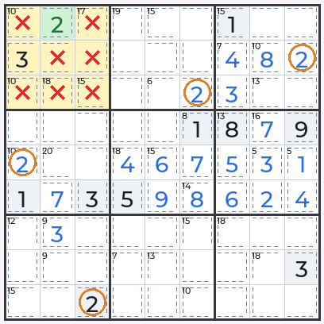

<!-- Written by tools/walkthrough.py killer: edit the script, not this page. -->
# Killer, step 21: the 2 in box 1

**Step 21 of 71** · [← Step 20](step-20.md) · [All steps](../killer.md#the-whole-puzzle-step-by-step) · [Step 22 →](step-22.md)

Box 1 needs a 2. r1c1: column 1 has one (r5c1). r1c3: column 3 has one (r9c3). r2c2 and r2c3: row 2 has one (r2c9). r3c1, r3c2 and r3c3: row 3 has one (r3c6). Only **r1c2** is left: **r1c2 = 2**.

**Step 21 of 71** · [← Step 20](step-20.md) · [All steps](../killer.md#the-whole-puzzle-step-by-step) · [Step 22 →](step-22.md)
