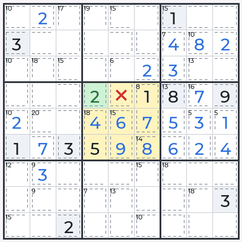

<!-- Written by tools/walkthrough.py killer: edit the script, not this page. -->
# Killer, step 22: the 2 in box 5

**Step 22 of 71** · [← Step 21](step-21.md) · [All steps](../killer.md#the-whole-puzzle-step-by-step) · [Step 23 →](step-23.md)

Box 5 needs a 2. r4c5: the cage of 6 (with 2 already in it) has a 2 already. Only **r4c4** is left: **r4c4 = 2**.

**Step 22 of 71** · [← Step 21](step-21.md) · [All steps](../killer.md#the-whole-puzzle-step-by-step) · [Step 23 →](step-23.md)
