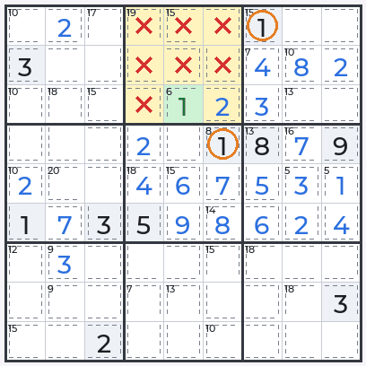

<!-- Written by tools/walkthrough.py killer: edit the script, not this page. -->
# Killer, step 23: the 1 in box 2

**Step 23 of 71** · [← Step 22](step-22.md) · [All steps](../killer.md#the-whole-puzzle-step-by-step) · [Step 24 →](step-24.md)

Box 2 needs a 1. r1c4, r1c5 and r1c6: row 1 has one (r1c7). r2c6: column 6 has one (r4c6). r2c4 and r2c5: in the cage of 19, a 1 would leave 18 for its other 2 cells, too much. r3c4: in the cage of 15 (with 2 already in it), a 1 would leave 12 for its other cell, too much. Only **r3c5** is left: **r3c5 = 1**.

**Step 23 of 71** · [← Step 22](step-22.md) · [All steps](../killer.md#the-whole-puzzle-step-by-step) · [Step 24 →](step-24.md)
