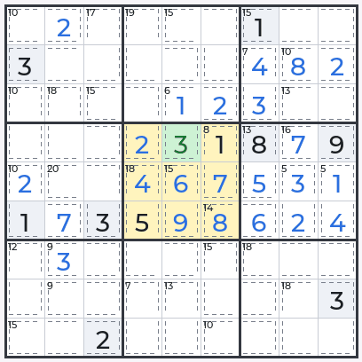

<!-- Written by tools/walkthrough.py killer: edit the script, not this page. -->
# Killer, step 24: the 3 in box 5

**Step 24 of 71** · [← Step 23](step-23.md) · [All steps](../killer.md#the-whole-puzzle-step-by-step) · [Step 25 →](step-25.md)

Box 5 needs a 3, and r4c5 is its last empty cell: **r4c5 = 3**.

**Step 24 of 71** · [← Step 23](step-23.md) · [All steps](../killer.md#the-whole-puzzle-step-by-step) · [Step 25 →](step-25.md)
