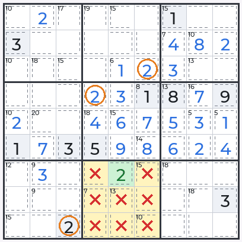

<!-- Written by tools/walkthrough.py killer: edit the script, not this page. -->
# Killer, step 25: the 2 in box 8

**Step 25 of 71** · [← Step 24](step-24.md) · [All steps](../killer.md#the-whole-puzzle-step-by-step) · [Step 26 →](step-26.md)

Box 8 needs a 2. r7c4 and r8c4: column 4 has one (r4c4). r7c6 and r8c6: column 6 has one (r3c6). r9c4, r9c5 and r9c6: row 9 has one (r9c3). r8c5: in the cage of 13, a 2 would leave 11 for its other cell, too much. Only **r7c5** is left: **r7c5 = 2**.

**Step 25 of 71** · [← Step 24](step-24.md) · [All steps](../killer.md#the-whole-puzzle-step-by-step) · [Step 26 →](step-26.md)
