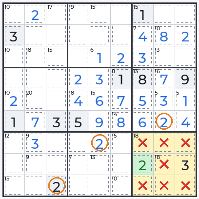

<!-- Written by tools/walkthrough.py killer: edit the script, not this page. -->
# Killer, step 26: the 2 in box 9

**Step 26 of 71** · [← Step 25](step-25.md) · [All steps](../killer.md#the-whole-puzzle-step-by-step) · [Step 27 →](step-27.md)

Box 9 needs a 2. r7c7, r7c8 and r7c9: row 7 has one (r7c5). r8c8: column 8 has one (r6c8). r9c7, r9c8 and r9c9: row 9 has one (r9c3). Only **r8c7** is left: **r8c7 = 2**.

**Step 26 of 71** · [← Step 25](step-25.md) · [All steps](../killer.md#the-whole-puzzle-step-by-step) · [Step 27 →](step-27.md)
