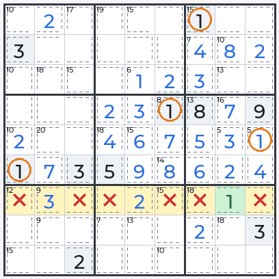

<!-- Written by tools/walkthrough.py killer: edit the script, not this page. -->
# Killer, step 27: the 1 in row 7

**Step 27 of 71** · [← Step 26](step-26.md) · [All steps](../killer.md#the-whole-puzzle-step-by-step) · [Step 28 →](step-28.md)

Row 7 needs a 1. r7c1: column 1 has one (r6c1). r7c6: column 6 has one (r4c6). r7c7: column 7 has one (r1c7). r7c9: column 9 has one (r5c9). r7c3: the cage of 9 (with 3 already in it) needs 6 there. r7c4: the cage of 18 (with 4, 5 and 2 already in it) needs 7 there. Only **r7c8** is left: **r7c8 = 1**.

**Step 27 of 71** · [← Step 26](step-26.md) · [All steps](../killer.md#the-whole-puzzle-step-by-step) · [Step 28 →](step-28.md)
