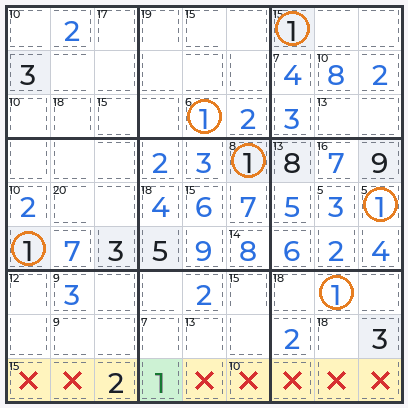

<!-- Written by tools/walkthrough.py killer: edit the script, not this page. -->
# Killer, step 28: the 1 in row 9

**Step 28 of 71** · [← Step 27](step-27.md) · [All steps](../killer.md#the-whole-puzzle-step-by-step) · [Step 29 →](step-29.md)

Row 9 needs a 1. r9c1: column 1 has one (r6c1). r9c5: column 5 has one (r3c5). r9c6: column 6 has one (r4c6). r9c7: column 7 has one (r1c7). r9c8: column 8 has one (r7c8). r9c9: column 9 has one (r5c9). r9c2: in the cage of 15 (with 2 already in it), a 1 would leave 12 for its other cell, too much. Only **r9c4** is left: **r9c4 = 1**.

**Step 28 of 71** · [← Step 27](step-27.md) · [All steps](../killer.md#the-whole-puzzle-step-by-step) · [Step 29 →](step-29.md)
