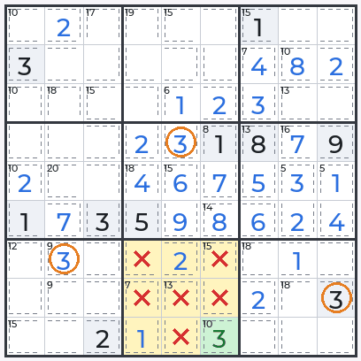

<!-- Written by tools/walkthrough.py killer: edit the script, not this page. -->
# Killer, step 29: the 3 in box 8

**Step 29 of 71** · [← Step 28](step-28.md) · [All steps](../killer.md#the-whole-puzzle-step-by-step) · [Step 30 →](step-30.md)

Box 8 needs a 3. r7c4 and r7c6: row 7 has one (r7c2). r8c4, r8c5 and r8c6: row 8 has one (r8c9). r9c5: column 5 has one (r4c5). Only **r9c6** is left: **r9c6 = 3**.

**Step 29 of 71** · [← Step 28](step-28.md) · [All steps](../killer.md#the-whole-puzzle-step-by-step) · [Step 30 →](step-30.md)
