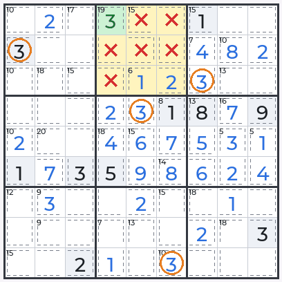

<!-- Written by tools/walkthrough.py killer: edit the script, not this page. -->
# Killer, step 30: the 3 in box 2

**Step 30 of 71** · [← Step 29](step-29.md) · [All steps](../killer.md#the-whole-puzzle-step-by-step) · [Step 31 →](step-31.md)

Box 2 needs a 3. r1c5: column 5 has one (r4c5). r1c6: column 6 has one (r9c6). r2c4, r2c5 and r2c6: row 2 has one (r2c1). r3c4: row 3 has one (r3c7). Only **r1c4** is left: **r1c4 = 3**.

**Step 30 of 71** · [← Step 29](step-29.md) · [All steps](../killer.md#the-whole-puzzle-step-by-step) · [Step 31 →](step-31.md)
