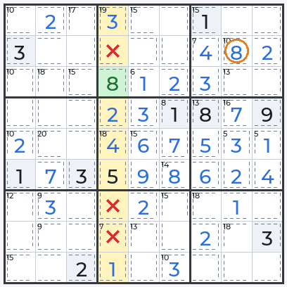

<!-- Written by tools/walkthrough.py killer: edit the script, not this page. -->
# Killer, step 31: the 8 in column 4

**Step 31 of 71** · [← Step 30](step-30.md) · [All steps](../killer.md#the-whole-puzzle-step-by-step) · [Step 32 →](step-32.md)

Column 4 needs an 8. r2c4: row 2 has one (r2c8). r7c4: the cage of 18 (with 4, 5 and 2 already in it) needs 7 there. r8c4: the cage of 7 (with 1 already in it) needs 6 there. Only **r3c4** is left: **r3c4 = 8**.

**Step 31 of 71** · [← Step 30](step-30.md) · [All steps](../killer.md#the-whole-puzzle-step-by-step) · [Step 32 →](step-32.md)
