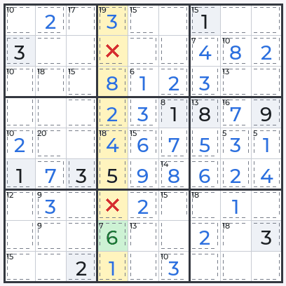

<!-- Written by tools/walkthrough.py killer: edit the script, not this page. -->
# Killer, step 32: the 6 in column 4

**Step 32 of 71** · [← Step 31](step-31.md) · [All steps](../killer.md#the-whole-puzzle-step-by-step) · [Step 33 →](step-33.md)

Column 4 needs a 6. r2c4: in the cage of 19 (with 3 already in it), a 6 would leave 10 for its other cell, too much. r7c4: the cage of 18 (with 4, 5 and 2 already in it) needs 7 there. Only **r8c4** is left: **r8c4 = 6**.

**Step 32 of 71** · [← Step 31](step-31.md) · [All steps](../killer.md#the-whole-puzzle-step-by-step) · [Step 33 →](step-33.md)
