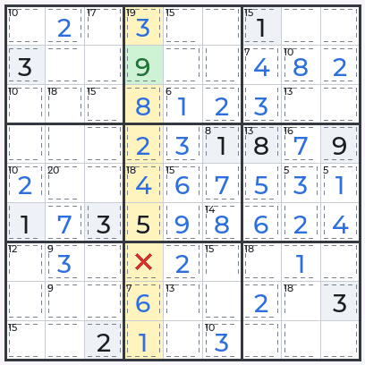

<!-- Written by tools/walkthrough.py killer: edit the script, not this page. -->
# Killer, step 33: the 9 in column 4

**Step 33 of 71** · [← Step 32](step-32.md) · [All steps](../killer.md#the-whole-puzzle-step-by-step) · [Step 34 →](step-34.md)

Column 4 needs a 9. r7c4: the cage of 18 (with 4, 5 and 2 already in it) needs 7 there. Only **r2c4** is left: **r2c4 = 9**.

**Step 33 of 71** · [← Step 32](step-32.md) · [All steps](../killer.md#the-whole-puzzle-step-by-step) · [Step 34 →](step-34.md)
