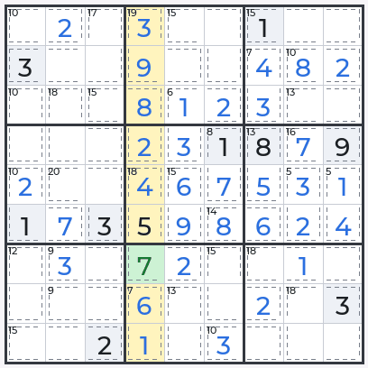

<!-- Written by tools/walkthrough.py killer: edit the script, not this page. -->
# Killer, step 34: the 7 in column 4

**Step 34 of 71** · [← Step 33](step-33.md) · [All steps](../killer.md#the-whole-puzzle-step-by-step) · [Step 35 →](step-35.md)

Column 4 needs a 7, and r7c4 is its last empty cell: **r7c4 = 7**.

**Step 34 of 71** · [← Step 33](step-33.md) · [All steps](../killer.md#the-whole-puzzle-step-by-step) · [Step 35 →](step-35.md)
