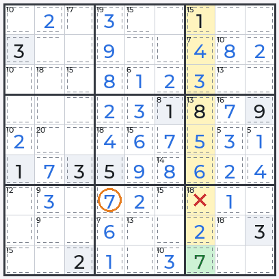

<!-- Written by tools/walkthrough.py killer: edit the script, not this page. -->
# Killer, step 35: the 7 in column 7

**Step 35 of 71** · [← Step 34](step-34.md) · [All steps](../killer.md#the-whole-puzzle-step-by-step) · [Step 36 →](step-36.md)

Column 7 needs a 7. r7c7: row 7 has one (r7c4). Only **r9c7** is left: **r9c7 = 7**.

**Step 35 of 71** · [← Step 34](step-34.md) · [All steps](../killer.md#the-whole-puzzle-step-by-step) · [Step 36 →](step-36.md)
