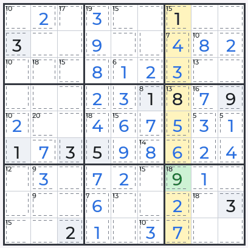

<!-- Written by tools/walkthrough.py killer: edit the script, not this page. -->
# Killer, step 36: the 9 in column 7

**Step 36 of 71** · [← Step 35](step-35.md) · [All steps](../killer.md#the-whole-puzzle-step-by-step) · [Step 37 →](step-37.md)

Column 7 needs a 9, and r7c7 is its last empty cell: **r7c7 = 9**.

**Step 36 of 71** · [← Step 35](step-35.md) · [All steps](../killer.md#the-whole-puzzle-step-by-step) · [Step 37 →](step-37.md)
