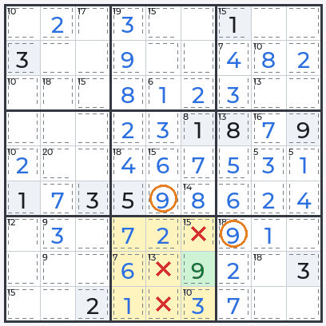

<!-- Written by tools/walkthrough.py killer: edit the script, not this page. -->
# Killer, step 37: the 9 in box 8

**Step 37 of 71** · [← Step 36](step-36.md) · [All steps](../killer.md#the-whole-puzzle-step-by-step) · [Step 38 →](step-38.md)

Box 8 needs a 9. r7c6: row 7 has one (r7c7). r8c5 and r9c5: column 5 has one (r6c5). Only **r8c6** is left: **r8c6 = 9**.

**Step 37 of 71** · [← Step 36](step-36.md) · [All steps](../killer.md#the-whole-puzzle-step-by-step) · [Step 38 →](step-38.md)
