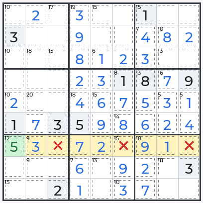

<!-- Written by tools/walkthrough.py killer: edit the script, not this page. -->
# Killer, step 38: the 5 in row 7

**Step 38 of 71** · [← Step 37](step-37.md) · [All steps](../killer.md#the-whole-puzzle-step-by-step) · [Step 39 →](step-39.md)

Row 7 needs a 5. r7c3: the cage of 9 (with 3 already in it) needs 6 there. r7c6: the cage of 15 (with 9 and 2 already in it) needs 4 there. r7c9: the cage of 18 (with 9 and 1 already in it) needs 8 there. Only **r7c1** is left: **r7c1 = 5**.

**Step 38 of 71** · [← Step 37](step-37.md) · [All steps](../killer.md#the-whole-puzzle-step-by-step) · [Step 39 →](step-39.md)
