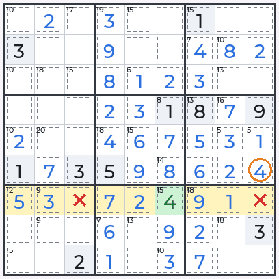

<!-- Written by tools/walkthrough.py killer: edit the script, not this page. -->
# Killer, step 39: the 4 in row 7

**Step 39 of 71** · [← Step 38](step-38.md) · [All steps](../killer.md#the-whole-puzzle-step-by-step) · [Step 40 →](step-40.md)

Row 7 needs a 4. r7c9: column 9 has one (r6c9). r7c3: the cage of 9 (with 3 already in it) needs 6 there. Only **r7c6** is left: **r7c6 = 4**.

**Step 39 of 71** · [← Step 38](step-38.md) · [All steps](../killer.md#the-whole-puzzle-step-by-step) · [Step 40 →](step-40.md)
