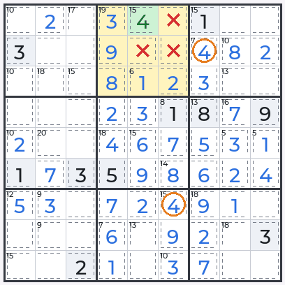

<!-- Written by tools/walkthrough.py killer: edit the script, not this page. -->
# Killer, step 40: the 4 in box 2

**Step 40 of 71** · [← Step 39](step-39.md) · [All steps](../killer.md#the-whole-puzzle-step-by-step) · [Step 41 →](step-41.md)

Box 2 needs a 4. r1c6: column 6 has one (r7c6). r2c5 and r2c6: row 2 has one (r2c7). Only **r1c5** is left: **r1c5 = 4**.

**Step 40 of 71** · [← Step 39](step-39.md) · [All steps](../killer.md#the-whole-puzzle-step-by-step) · [Step 41 →](step-41.md)
