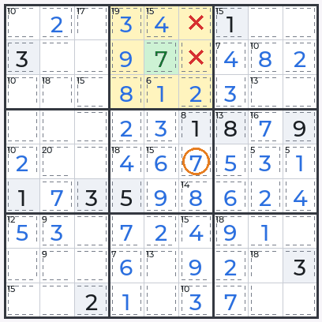

<!-- Written by tools/walkthrough.py killer: edit the script, not this page. -->
# Killer, step 41: the 7 in box 2

**Step 41 of 71** · [← Step 40](step-40.md) · [All steps](../killer.md#the-whole-puzzle-step-by-step) · [Step 42 →](step-42.md)

Box 2 needs a 7. r1c6 and r2c6: column 6 has one (r5c6). Only **r2c5** is left: **r2c5 = 7**.

**Step 41 of 71** · [← Step 40](step-40.md) · [All steps](../killer.md#the-whole-puzzle-step-by-step) · [Step 42 →](step-42.md)
